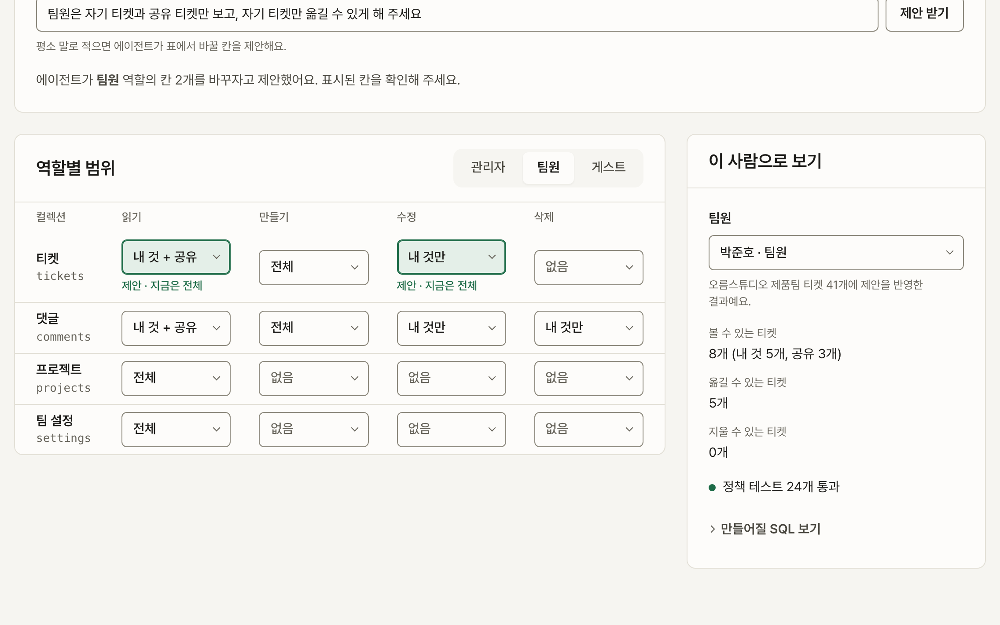
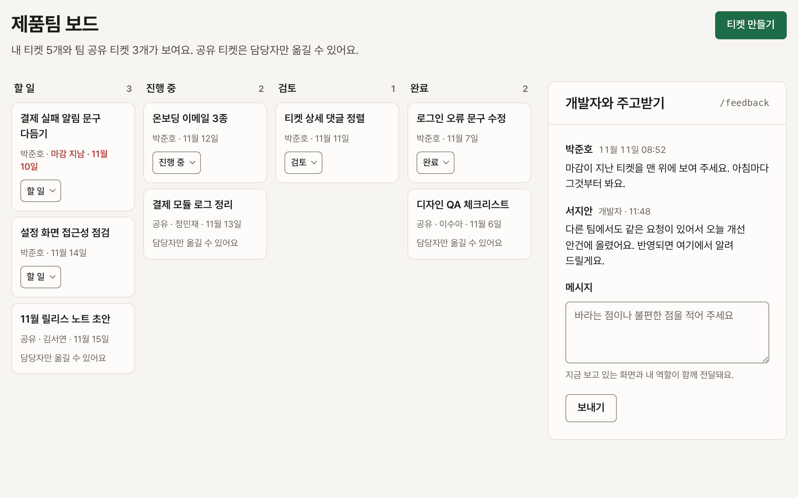
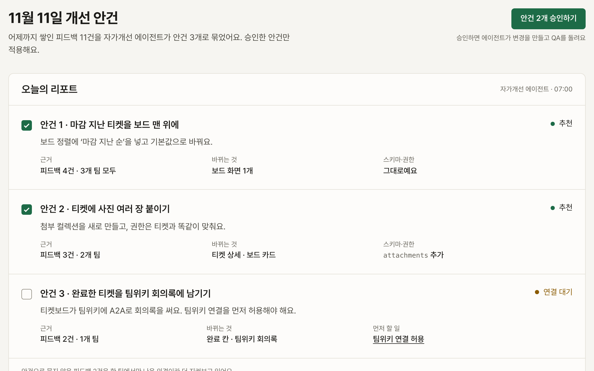
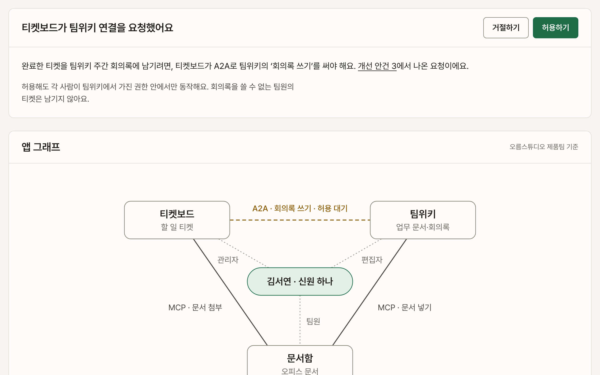

# Kelay

A cloud for small software. A builder describes an app, shares it with a customer team in one step, and grows it from that team's feedback. Agents run on each person's own Claude, inside their own permissions.

This repository holds the design preview only. There is no product code yet.

## Preview

Open [`design/preview/index.html`](design/preview/index.html) in a browser. It is the demo storyboard: three acts, eight scenes, and every scene links to its screen. The pages are static HTML with no build step; the only network request is the Pretendard font.

| # | Scene | Screen | Seen by |
|---|---|---|---|
| 1 | One paragraph becomes an app | [`build.html`](design/preview/build.html) | builder |
| 2 | A rule written in words becomes a permission policy | [`access.html`](design/preview/access.html) | builder |
| 3 | Share with a team in one click | [`ship.html`](design/preview/ship.html) | builder |
| 4 | The same error is blocked by structure | [`qa.html`](design/preview/qa.html) | builder |
| 5 | Feedback from the screen you are using | [`board.html`](design/preview/board.html) | customer |
| 6 | Your own Claude, working within your permissions | [`agent.html`](design/preview/agent.html) | customer |
| 7 | A daily report of improvement items | [`feedback.html`](design/preview/feedback.html) | builder |
| 8 | Small apps connect and grow together | [`connect.html`](design/preview/connect.html) | builder |

## Design system

- [`DESIGN.md`](DESIGN.md) is the design contract. It uses the oh-my-design Core v2 layout: principles, then decisions (`D-*`), then tokens, components, layout, content and governance.
- [`design/preview/styles.css`](design/preview/styles.css) holds the tokens. Each one traces back to a decision in DESIGN.md.
- [`design/.reviews/omd-review-round-1.md`](design/.reviews/omd-review-round-1.md) records the review: hangul typography and copy checks, rendered line breaks, restraint, contrast, and slop gates.

Screen copy is Korean (`ko`). Documentation and code comments are English.
