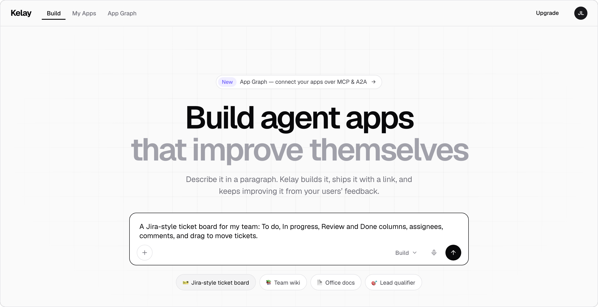
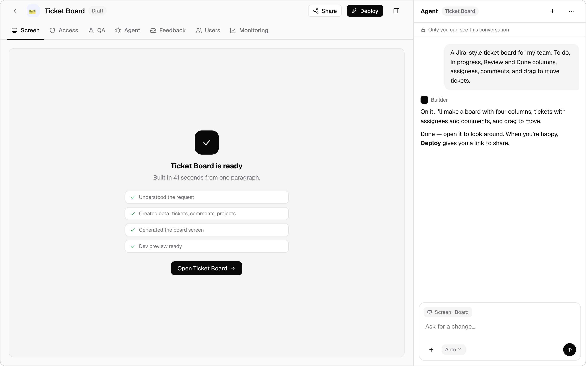
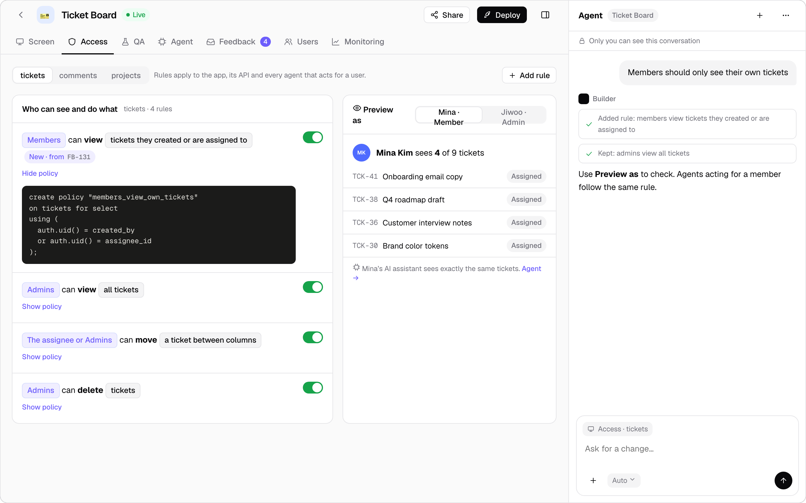
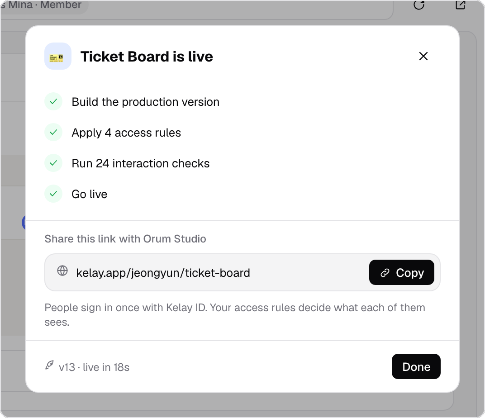
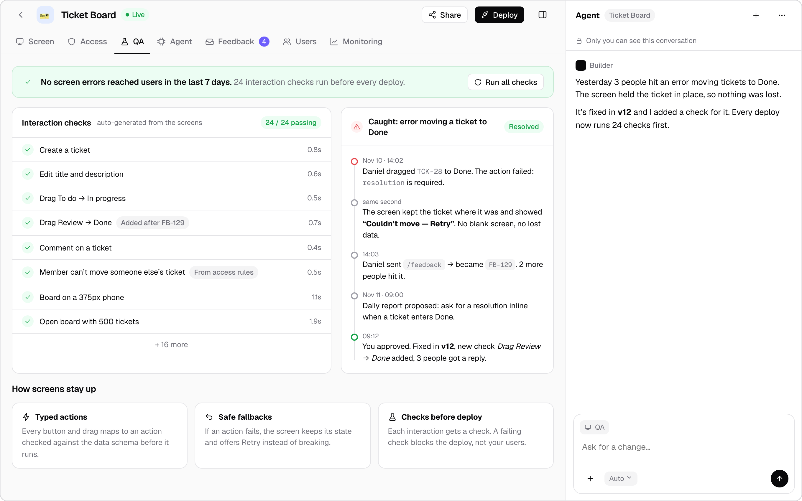
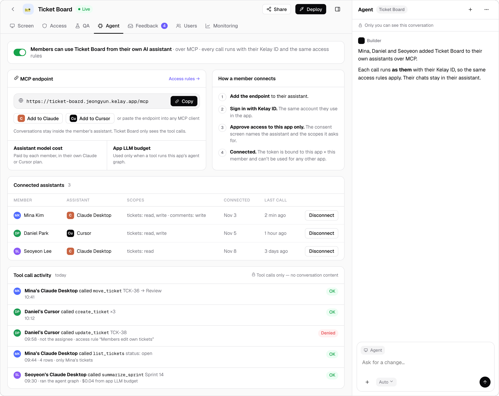
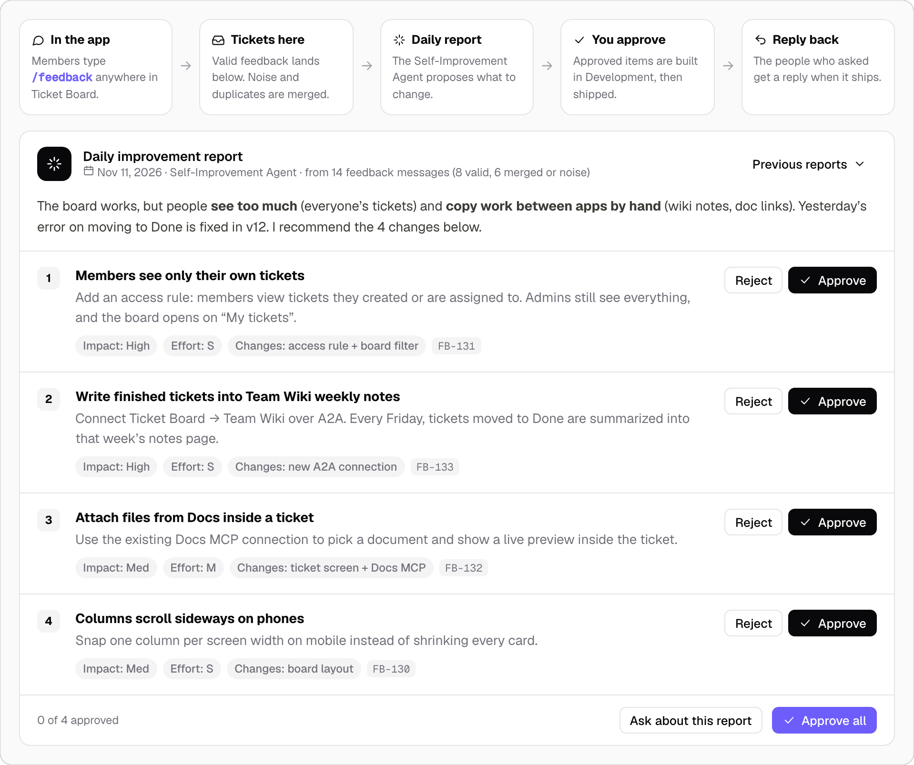
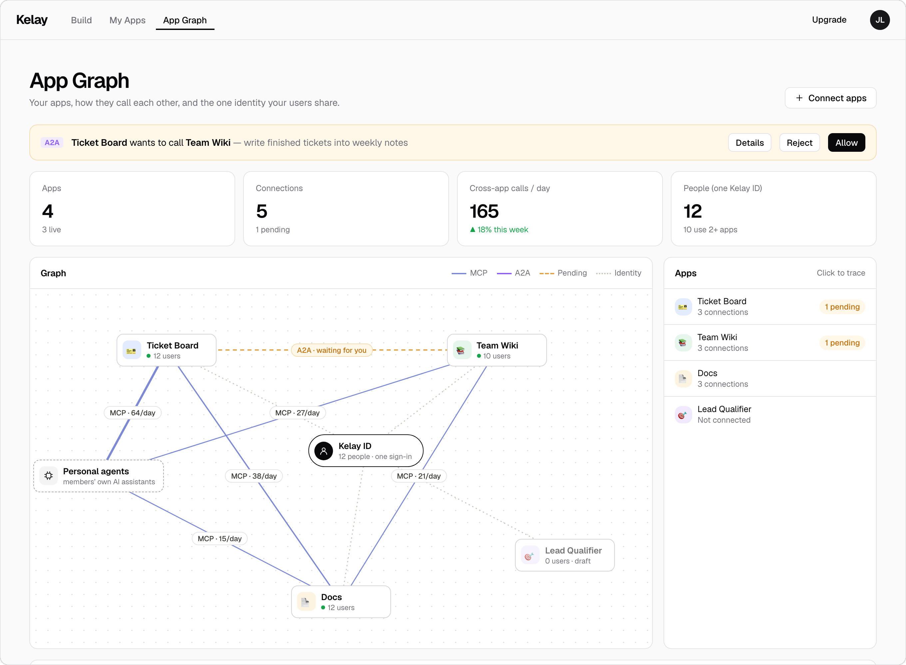
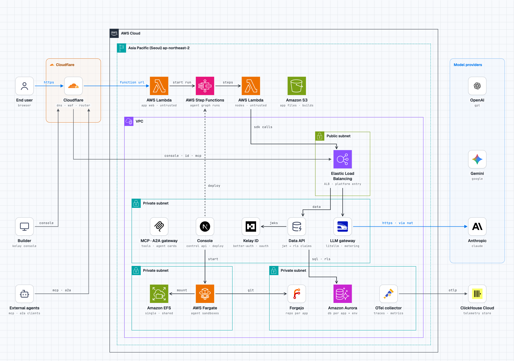

<p align="center">
  
</p>

<h1 align="center">Kelay</h1>

<p align="center">
  <b>A cloud for small software.</b>
</p>

<p align="center">
  For an agent to meet real customers, it has to get more niche.<br>
  For a builder to focus on one niche customer and nothing else,<br>
  the cost to ship has to come down. That is why we built Kelay.
</p>

<p align="center">
  <a href="#what-builders-asked-for">What builders asked for</a> ·
  <a href="#one-scenario-seven-scenes">One scenario</a> ·
  <a href="#what-we-gave-up">What we gave up</a> ·
  <a href="#architecture">Architecture</a> ·
  <a href="#try-the-prototype">Try it</a>
</p>

## What builders asked for

In one line, Kelay is a vibe-codable Notion, a self-improving Vercel + Supabase, and an easier AWS built for software agents. It lets small software get built and shipped simply. Each part of it answers something a builder told us.

| A builder says | Kelay gives them | See it |
|---|---|---|
| “I want to design access policies with RLS.” | A screen for access rules. Each rule is a sentence backed by a row-level security policy, with a preview of what any member sees. | [Scene&nbsp;2](#2--access-rules) |
| “I want to improve from what paying customers tell me.” | A feedback loop. Users type `/feedback` inside the app, a daily report proposes changes, and the builder approves. | [Scene&nbsp;6](#6--feedback-loop) |
| “I want to ship right away.” | One step from Deploy to a link the team can open. | [Scene&nbsp;3](#3--ship) |
| “I want to offer it BYOK.” | Members connect their own AI assistant. It acts with their identity and access rules, and the model cost stays on their own plan. | [Scene&nbsp;5](#5--own-agent) |
| “I want to spend less time on QA for simple errors.” | A Next.js SDK that opens up screen features only, so a failed action cannot break the screen. | [Scene&nbsp;4](#4--qa) |
| “I want small software to compound through A2A and MCP.” | MCP and A2A are built in. Apps call each other, and one identity opens all of them. | [Scene&nbsp;7](#7--app-graph) |

With these, a builder can ship an agentic service that a whole team uses, on Kelay alone, without designing for scale-out.

## One scenario, seven scenes

A builder wants software that manages a team's tickets. The prototype plays that scenario from the first paragraph to three connected apps, and each scene starts from a need.

> [!NOTE]
> The screens below come from the prototype, a clickable mock-up with sample data. [`apps/console`](apps/console) ports it to Next.js and serves the same sample data unless it is pointed at the Control API.

### 1 · Build

> Building should be as easy as describing it.

One paragraph becomes a Jira-style ticket board, with screens and data, in under a minute. Building is the easy part. The next six scenes are where small software usually gets expensive.



### 2 · Access rules

> No access rules. Members want to see only their own tickets.

Access rules are written as sentences, such as *Members can view tickets they created or are assigned to*. Each sentence opens to show the row-level security policy behind it, and **Preview as** shows the data as any member would see it.



### 3 · Ship

> Shipping is hard. The builder wants to share it right away.

Deploy builds the production version, applies the access rules, runs the interaction checks and goes live. It hands back one link to share with the team.

<p align="center">
  
</p>

### 4 · QA

> After sharing, moving a ticket threw a simple error.

The screen is built so that it does not break. When an action fails, the screen keeps its state and offers Retry, and the fix adds a check that runs before every deploy.



### 5 · Own agent

> Members want to use Ticket Board from their own AI assistant.

Members add the app to their own Claude or Cursor over MCP, so the model cost stays on their own plan. Every call runs with their Kelay ID and the same access rules. The app sees the tool calls and never the conversation.



### 6 · Feedback loop

> Feedback should turn into improvements right away.

Members type `/feedback` anywhere in the app. Valid feedback piles up as tickets, the Self-Improvement Agent turns them into a daily report of proposed changes, and the builder approves the ones to build. The people who asked get a reply when the change ships.



### 7 · App graph

> Ticket Board, a wiki and docs should work together.

MCP and A2A connect the apps, and one Kelay ID opens all of them. A new connection waits for the builder's approval, and each call keeps the member's own access. Small software compounds.



## What we gave up

Keeping it this simple has a price. A builder on Kelay cannot:

- run a multi-tenant system
- configure permissions or run security beyond RLS
- optimize software at the millisecond level
- choose a stack other than the Next.js SDK

## Architecture

What Kelay runs so that a builder does not have to. This is the target platform, and [`docs/infrastructure.md`](docs/infrastructure.md) explains the decisions, the trust boundary and the build order.

<picture>
  <source media="(prefers-color-scheme: dark)" srcset="docs/stack-diagram-dark.png">
  
</picture>

- **Shipped apps** run as untrusted code on AWS Lambda, and AWS Step Functions drives each agent run.
- **The platform** sits behind one load balancer: the Console, Kelay ID, the Data API that applies RLS, the LLM gateway, and the MCP · A2A gateway.
- **Each app** gets its own repository and its own database per environment.

This boundary is what turns the give-ups above into guarantees. App code holds no database password and no model provider key, and it reaches data only through RLS.

## Try the prototype

Open [`design/prototype/index.html`](design/prototype/index.html) in a browser. It is the canonical prototype: one HTML file with no build step, whose only network requests are for the Geist fonts. Everything on screen is sample data, and a reload resets it.

The dark bar at the bottom left is the map. **Story 1–7** walks the scenes above in order, and the links after it open the other screens. A caption card on each scene states the need and Kelay's answer.

| Screen | Route |
|---|---|
| Build | `#/` |
| My Apps | `#/apps` |
| App Graph | `#/graph` |
| Workspace | `#/app/ticket-board/<tab>`, where the tab is `screen`, `access`, `qa`, `agent`, `feedback`, `users` or `monitoring` |
| Deploy dialog | any workspace route followed by `/ship` |

## Run locally

One command brings up the platform on real data, with nothing mocked. It needs Node 22+, pnpm and Docker.

```sh
pnpm install
pnpm dev:up
```

`pnpm dev:up` does these things in order:

1. starts Postgres with Docker Compose (port 54320);
2. migrates the control DB (Control API and Kelay ID tables) and the Ticket Board app database (tables and row-level security generated by `@kelay/policy`);
3. seeds the Ticket Board scenario;
4. starts the LLM gateway (LiteLLM, port 4000) when `ANTHROPIC_API_KEY` is set in `.env` or the shell;
5. starts Kelay ID, the Data API, the Control API, the run orchestrator, the MCP gateway, the Builder and the console, and prints their URLs.

| What | URL |
|---|---|
| Console, signed in as the builder | <http://localhost:4005/> (sets the cookie, then opens <http://localhost:3000>) |
| Kelay ID | <http://localhost:4001> |
| Data API | <http://localhost:4002> |
| Control API | <http://localhost:4003> |
| MCP gateway | <http://localhost:4004/orum/ticket-board/mcp> |
| Run orchestrator | <http://localhost:4007> |
| LLM gateway, only with `ANTHROPIC_API_KEY` | <http://localhost:4000> |
| Builder | <http://localhost:4006> |

**Signing in to the console.** The console reads the builder's Kelay ID token from the `kelay_token` cookie. Open <http://localhost:4005/>: a helper that runs only under `pnpm dev:up` signs the seeded builder in at Kelay ID, sets the cookie and sends you to the console. The token lasts 15 minutes; open that address again for a fresh one. `pnpm dev:login` prints a token instead, to paste at <http://localhost:3000/signin>.

**Seeded data.** Every account uses the password `kelay-dev-password`.

| Account | Role |
|---|---|
| `jeongyun@orum.test` | Builder; owns Ticket Board, Team Wiki and Docs under the handle `orum` |
| `seoyeon@orum.test` | Ticket Board admin |
| `junho@orum.test`, `mina@orum.test`, `daniel@orum.test` | Ticket Board members |
| `hyunwoo@orum.test` | Ticket Board guest |

The seed also adds board tickets, projects and comments to the app database, and feedback tickets, two improvement reports with proposals, app-to-app connections and assistant consents to the control DB. The data follows the prototype and lives in [`scripts/lib/data.ts`](scripts/lib/data.ts).

So that Monitoring and the Agent tab are not empty, the seed records 14 days of activity as well: screen actions, tool calls from the two seeded assistants and calls between the connected apps ([`scripts/lib/activity.ts`](scripts/lib/activity.ts)). An app that already has runs is left alone. From then on the activity is real: the MCP gateway reports every tool call to the Control API (`CONTROL_API_URL`), so a call you make from an assistant shows up in the Agent tab a few seconds later.

**Other commands.**

| Command | What it does |
|---|---|
| `pnpm dev:down` | Stops the services and Postgres. Data stays in the Docker volume; add `--volumes` to delete it. |
| `pnpm seed` | Migrates and seeds again. It needs only Postgres (`pnpm db:up`) and skips what already exists. |
| `pnpm e2e` | Runs the end-to-end suite described below. |

To change a port or a secret, copy [`.env.example`](.env.example) to `.env` and edit it.

**Building an app from the Home prompt.** The prompt on the console's Home page creates an app and a Builder workspace under `.kelay/workspaces/`, builds it, deploys it to Development (which creates its database `app_<slug>_dev`) and starts its dev preview. Without `ANTHROPIC_API_KEY` in `.env` the Builder runs its scripted demo agent, which makes the Ticket Board app whatever the prompt says, and the console says so. With the key, Claude builds from the prompt. See [`services/builder`](services/builder/README.md).

**Agent runs.** The run orchestrator executes Ticket Board's `overdue-summary` graph with the nodes in [`examples/ticket-board-nodes`](examples/ticket-board-nodes). An assistant starts it with the `action_summarize_overdue` tool, another app with an A2A message, and each run shows on the Monitoring tab with its caller.

**Model calls.** Feedback triage, "run report" and the `summarize` and `prioritize` nodes call the model through the LLM gateway. Without `ANTHROPIC_API_KEY` the stack starts with no gateway and those calls fail with "LLM gateway not configured"; everything else works. To use a gateway that runs elsewhere, set `LLM_GATEWAY_URL` and `LLM_GATEWAY_KEY`.

**Not started locally.** The router is not part of `pnpm dev:up`, so public app links (`KELAY_APP_ORIGIN`) have nothing behind them.

### End-to-end test

`pnpm e2e` starts its own Postgres container (port 54336) and its own copies of the five services (ports 4411–4414 and 4417), seeds them with the same data, and removes everything afterwards. A running `pnpm dev:up` is not touched. The suite in [`e2e/`](e2e) checks the Ticket Board path:

- Junho signs in at Kelay ID and gets a Ticket Board token with his role;
- the Data API returns only his own tickets and the shared ones, lets him move his own ticket, and denies a change to someone else's;
- an access rule the builder saves and deploys through the Control API changes what the Data API returns to Junho;
- feedback sent with `sendFeedback` from `@kelay/sdk` becomes a ticket that the builder sees in the Control API;
- an assistant completes the OAuth authorization-code flow (PKCE, consent page), and the MCP gateway's `tickets_list` returns the same rows as the screen;
- the builder sees those tool calls in the Control API (`GET /v1/apps/ticket-board/tool-calls`) next to the seeded ones;
- the assistant's `action_summarize_overdue` call runs the `overdue-summary` graph through the run orchestrator as Junho, returns his overdue tickets, and is recorded as a personal agent's run with one entry per node;
- an A2A `SendMessage` from Team Wiki runs the same graph once the builder allows the link, and is refused for an app without a connected link.

The graph's nodes are the real ones from `examples/ticket-board-nodes`; only the model is replaced by that package's test double ([`e2e/ticket-board-nodes.ts`](e2e/ticket-board-nodes.ts)), so the suite needs no provider key and calls no model.

Service logs from the run are in `node_modules/.cache/kelay/e2e/services.log`.

## In this repository

| Path | What it is |
|---|---|
| [`design/prototype/index.html`](design/prototype/index.html) | The canonical prototype, with sample data |
| [`design/screenshots/`](design/screenshots) | Captures of the prototype, used on this page |
| [`apps/console`](apps/console) | The console, a Next.js port of the prototype. [`PROTOTYPE_SYNC.md`](apps/console/PROTOTYPE_SYNC.md) maps each prototype screen to its console file |
| [`packages/`](packages) | `sdk` is what Kelay apps import, and `runtime` is what their agent nodes are written against. `contracts`, `policy`, `graph` and `tokens` hold the shared types, the RLS generator, the agent graph compiler and the token helpers |
| [`services/`](services) | `control-api`, `data-api`, `identity` (Kelay ID), `mcp-gateway`, `runner` (the run orchestrator) and `router` |
| [`examples/ticket-board-nodes`](examples/ticket-board-nodes) | Ticket Board's agent graph nodes (collect → summarize ∥ prioritize → review), written with `@kelay/runtime` |
| [`examples/live-rls`](examples/live-rls) | A live demo of the trust boundary, where Postgres RLS decides what each person can see and move |
| [`docs/infrastructure.md`](docs/infrastructure.md) | The infrastructure design |
| [`docs/contracts.md`](docs/contracts.md) | The contracts that every service and package builds against |
