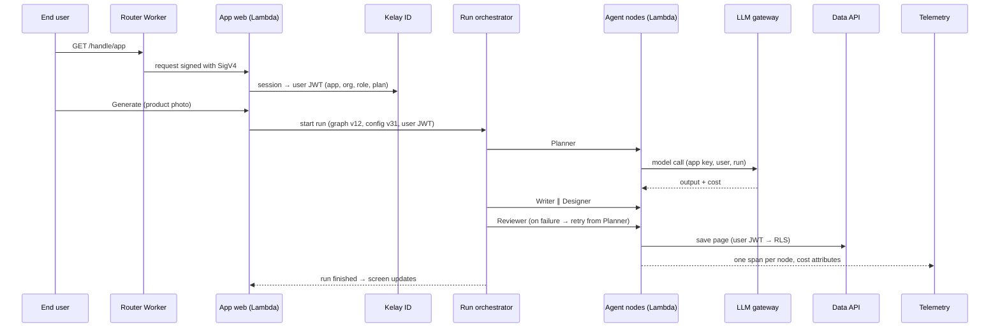
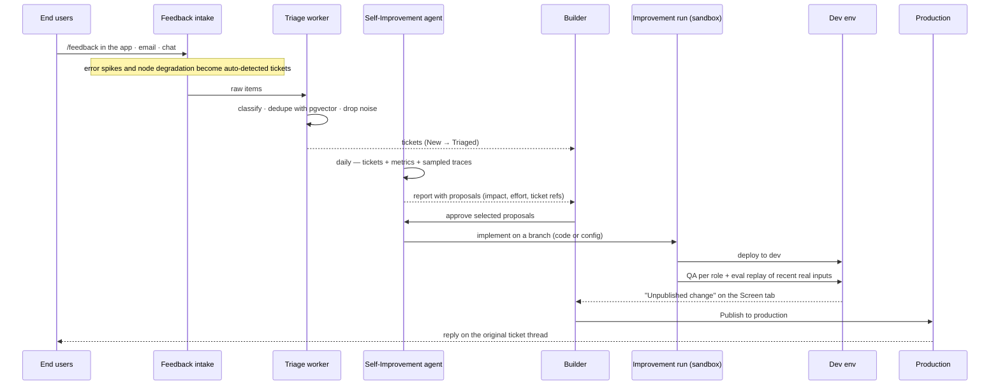

# Kelay infrastructure

This document describes what has to run for the prototype in [`design/prototype/index.html`](../design/prototype/index.html) to work for real. The prototype is the source of truth for product behavior. It shows:

- Home: one prompt that builds an agent app.
- My Apps: apps served at `/<handle>/<app>`, plus a shareable store page.
- Workspace tabs: Screen with dev and production, Monitoring, Users with end-user auth and plans, and Feedback with the daily improvement report and tickets.
- A Builder agent chat panel, and a Share modal that hands out the production link.
- App Graph: every app of a builder, linked over MCP and A2A. People share one Kelay ID, and their own AI assistants call the apps over MCP.

It also covers the core scenario:

- permissions as RLS;
- one-step sharing;
- screens that cannot crash on a denied action;
- personal agents: the AI assistants users already run (Claude Desktop, Cursor and others), calling apps over MCP;
- `/feedback` threads;
- MCP and A2A between apps under one identity.

## 1. Decisions

| Area | Choice | Why |
|---|---|---|
| Region | AWS `ap-northeast-2` (Seoul), single region | Users and Kakao sign-in are in Korea. Neon offers only Singapore and Sydney in Asia-Pacific, and Fly.io has no Seoul region. The team already runs ECS. |
| Tenancy | Pooled platform, isolated per app | Each app gets its own runtime functions, Postgres database and role, and storage prefix. Teams and orgs inside an app are separated by RLS. Builders never operate tenancy. |
| Trust boundary | Builder code is untrusted | Agent-written code holds no database password and no model provider key. It reaches data, files and models only through platform services, with a token scoped to the user. |
| App runtime | AWS Lambda per app × env; Next.js packaged with OpenNext | Most small software is idle, so it scales to zero. Each execution environment is a Firecracker microVM. The SDK fixes the stack, so the build is the same for every app. |
| Agent runs | AWS Step Functions, generated from the app's agent graph | The graph in the prototype (Planner → Writer ∥ Designer → Reviewer, with a retry loop) maps onto states with retries, timeouts, parallel branches and per-state metrics. Express workflows cover runs under 5 minutes; Standard covers longer ones. |
| Agent config | Prompts, models and tool configs versioned apart from code, per env | The most common self-improvement change ("writer system prompt", "image tool config") ships without a rebuild. It still goes through eval and publish. |
| Data | Aurora PostgreSQL Serverless v2. One database per app and env, behind a shared Data API and RDS Proxy | Postgres RLS is the permission model. The Data API is the only path to app data, which makes RLS impossible to bypass from builder code. |
| Identity | One Kelay ID for every app (better-auth). Per-app membership holds plan, status and role | The Users tab needs Google, Kakao, GitHub and email sign-in, plus plans and bans. better-auth ships a Kakao provider, an OAuth 2.1 provider, an MCP authorization plugin and a Client ID Metadata Document plugin. The same identity therefore authorizes users' own AI assistants. |
| Models | LLM gateway (LiteLLM proxy) | Covers routing across Anthropic, OpenAI and Google, including "Auto"; virtual keys per app and env; per-user budgets by plan; cost per run and per user, as in the user drawer; and BYOK API keys. |
| Sandboxes | ECS Fargate tasks, one microVM each | Used only for the Builder agent workspace and for implementation runs of approved proposals. The image pre-bakes the fixed SDK toolchain, so a workspace starts from a git checkout. The coding agent calls models through the LLM gateway with Kelay's API keys. |
| Telemetry | OpenTelemetry → collector → ClickHouse | Powers the Monitoring tab (runs, success rate, p95 latency, cost, node health) and auto-detected tickets. |
| Code | Forgejo, one repo per app | Proposals become branches and diffs. AWS CodeCommit no longer accepts new customers. |
| Edge | Cloudflare DNS, TLS, WAF and CDN, plus a Router Worker | Path routing for `/<handle>/<app>` on the app domain. The Worker signs requests to Lambda function URLs that use IAM auth, so app functions are not public. |

## 2. Stack diagram

<picture>
  <source media="(prefers-color-scheme: dark)" srcset="stack-diagram-dark.png">
  
</picture>

- Drawn with the [stack-diagram](https://github.com/caru-ini/stack-diagram) skill.
- [`stack-diagram.html`](stack-diagram.html) is the self-contained source of truth; the PNGs are rendered from it.
- [`stack-diagram.src.html`](stack-diagram.src.html) is the editable draft, with `%%ICON_*%%` tokens. To rebuild it, fetch the icons again with the skill's `fetch_icons.py`; the AWS icon package stays out of the repo.

Reading the diagram:

- **Untrusted** (agent-written): the two Lambda roles marked `untrusted` and the Fargate builder workspaces. They hold no secrets.
- **External:** personal agents (users' own AI assistants) sit outside the diagram's AWS boundary and enter only through the MCP · A2A gateway.
- **Trusted:** everything behind Elastic Load Balancing in the private platform subnet.
- **Primary path:** user → Cloudflare → app web → Step Functions → agent nodes → load balancer → LLM gateway → model providers.

The same stack as layers, from the outside in:

| Layer | What runs there | Trust |
|---|---|---|
| Edge | DNS, TLS, WAF, CDN; Router Worker with the app route table in Workers KV | Platform |
| Control plane | Console (the real version of the prototype), Control API, Deploy service, feedback triage, Self-Improvement scheduler, Preview proxy | Platform |
| Shared trusted services | Kelay ID, Data API, Storage API, LLM gateway, Run orchestrator, MCP · A2A gateway, OTel collector | Platform; the SDK's only dependencies |
| Per-app plane | Web function and agent node functions for each app and env | Untrusted (agent-written) |
| Sandboxes | Builder workspace, improvement runs | Untrusted, isolated per task |
| Data | Control DB, app DBs, S3, Forgejo, ClickHouse | Platform |

## 3. Trust boundary

This boundary is what turns the product's give-ups into guarantees:

- **No tenancy ops for builders.** RLS is the only permission model. The app runtime cannot reach data except through RLS.

The rules:

- **App functions carry no secrets.** No database password, no provider key, no AWS permissions beyond logs. They get a short-lived app token minted at deploy, which identifies the app and env.
- **Every data call carries the end user's JWT** from Kelay ID. Its claims are `sub`, `app`, `org`, `role` and `plan`.
  - The Data API verifies the JWT and opens a transaction as the app's database role (`NOBYPASSRLS`).
  - It sets `request.jwt.claims` and runs the SDK's typed, parameterized query. Builder code cannot send raw SQL.
- **Agents act as someone.** A run started by a user carries that user's token through every node, so agent reads and writes hit the same RLS as the screen ("agents RLS").
- **External MCP calls run as the user.** A user's own AI assistant calls an app with a token that Kelay ID issued to that user for that app. Every tool call goes through the Data API with that token, so it hits the same RLS as the screen.
- **Files follow the same rules.** The Storage API checks the policy for the collection that owns the file, then returns a presigned S3 URL under the app's prefix.
- **Model calls are metered at the gateway.** The app key sets the provider keys, budgets and routing; the user and run IDs land on every cost record.
- **Screens cannot crash on a denied action.** SDK components check permissions before rendering an action. For example, a ticket you cannot move has no drag handle. When the server still refuses, the component rolls back and shows the reason. QA runs actions per role, not only page loads.

## 4. Flows

### 4.1 Build: Home prompt → dev preview

1. The Console sends the prompt to the Control API, which creates the app, its Forgejo repo and a dev env.
2. The Control API starts a Builder workspace task: an image with the SDK toolchain and the coding agent, with the app repo on an EFS access point.
3. The coding agent writes screens with the SDK and the agent graph spec. It commits on every turn, and runs `next dev`.
4. The Preview proxy, which runs in the Builder service, maps the dev preview URL to the task over HTTP and WebSocket (HMR). It lets only the app's builder through: the console gets a short-lived ticket for the preview frame, and the proxy trades it for a session cookie.
5. The workspace stops after 15 idle minutes. Its state lives in git and on EFS, so the next open resumes it.

### 4.2 End-user run

### 4.3 Feedback → daily report → approve → publish

- **Eval replay** re-runs a sample of recent production inputs against the dev config. An LLM judge then compares the outputs with production and checks the ticket's own assertion, for example "label not clipped". The inputs never leave the platform, and an app can opt out.
- **Publish** applies expand-only migrations to the prod database, publishes the agent config version, and switches the Lambda alias from the old version to the new one. Rollback moves the alias back.

### 4.4 One identity, MCP and A2A

- Kelay ID is the OAuth 2.1 authorization server for every app. A person signs in once and appears in each app's Users tab as a member with that app's plan, status and role.
- Every app exposes an MCP server through the MCP · A2A gateway. Its tools are generated from the app's collections and its declared actions; running the agent graph is one tool. The gateway also publishes an A2A agent card.
- MCP clients are users' own AI assistants (Claude Desktop, Cursor and others) and other Kelay apps. They get resource-bound tokens from Kelay ID, so every tool call runs under the caller's RLS.
- Kelay ID runs two better-auth plugins:
  - `mcp`: an OAuth 2.1 authorization server that serves RFC 9728 protected resource metadata and binds tokens to the configured resource.
  - `cimd`: the Client ID Metadata Document flow from MCP 2026-07-28.

  Dynamic Client Registration stays off.
- Consent is per app:
  1. The assistant's first call returns 401 with the app's protected resource metadata, which points at Kelay ID.
  2. The assistant identifies itself by the URL of its client metadata document; Kelay ID fetches and checks it.
  3. The user signs in with Kelay ID and approves this one app. The consent screen names the assistant and the scopes it asks for.
  4. Kelay ID issues a token bound to that app and that user. Another app needs its own consent, and revoking a consent ends the assistant's access to that app.
- App-to-app links (for example "Meeting Notes → Lead Qualifier: update lead scores") are grants recorded in the Control DB.
  - A pending link waits for Allow or Reject on the App Graph page.
  - The graph, the connection list and the call counts all read from those grants and from gateway telemetry.

### 4.5 Personal agents (external)

- **What they are.** A personal agent is the AI assistant a user already runs, such as Claude Desktop or Cursor.
  - Kelay does not host it and does not sign in to the user's model account.
  - Kelay never sees the assistant's conversation, only the tool calls that reach the app.
- **Connecting.** The user adds the app's MCP endpoint, shown on the App Graph, to their assistant and completes the consent flow in §4.4.
  - The endpoint is `/<handle>/<app>/mcp` on the app domain.
  - Calls take one path: Cloudflare → load balancer → MCP · A2A gateway.
  - Inside the app this is a connect screen, not a chat. It holds the endpoint, add-to-assistant links, and the connected assistants with a revoke button.
  - The conversation stays in the assistant. The app shows the changes the tool calls made and an activity log of those calls.
- **Token scope.** Each token covers one user, one app and one client. It is bound to that app's MCP resource and carries the user's role and plan, so RLS and plan limits apply as they do on the screen.
- **Limits and metering.** The gateway does three things:
  - rate-limits calls per user × app and per client;
  - caps concurrent agent-graph runs per user;
  - meters every call (tool, duration, caller) into telemetry.

  Monitoring lists these calls with "personal agent" as the caller.
- **Model cost.** The assistant's own model usage is the user's cost. Kelay runs only the app's tools. A tool that runs the app's agent graph spends the app's LLM budget under the user's plan, through the LLM gateway, like a run started from the screen.

## 5. Environments

| | Dev | Production |
|---|---|---|
| Code | Branch head, deployed on every approved change | Published version (Lambda alias) |
| Agent config | Draft version | Published version |
| Database | `<app>_dev`, seeded from a masked sample of prod | `<app>_prod` |
| URL | dev preview host; the builder only, or a share link for named testers | `/<handle>/<app>` on the app domain |
| Model budget | Builder's budget | Per-user budgets from the plan |

## 6. Prototype → services

| Prototype surface | Served by |
|---|---|
| Home prompt, "Building your app…" steps | Control API → Builder workspace task |
| My Apps, app cards (users, runs, new feedback) | Control DB (app registry) + ClickHouse rollups |
| Share store page modal (listed and hidden apps) | Control DB store settings; public store route on the Router Worker |
| Screen tab, dev preview, device toggle, "Unpublished change", Publish | Preview proxy → workspace `next dev`; Deploy service for publish |
| Monitoring KPIs, runs and errors chart, recent runs with caller (user, personal agent, other app) | ClickHouse queries over OTel spans and gateway cost records |
| Monitoring connections card | Grants + MCP · A2A gateway call counts |
| Users tab (providers, plans, status, ban, delete, recovery email) | Kelay ID + per-app membership; email through SES |
| Feedback report, proposals, approve, ticket board | Control DB (tickets, proposals) + triage worker + Self-Improvement agent |
| Agent chat panel ("Only you can see this conversation") | Builder workspace session; transcript stored per builder in S3 |
| Deploy, Share modal (production link) | Deploy service; the Router Worker serves the published alias |
| App Graph (apps, MCP / A2A links, Kelay ID, personal agents, pending requests, MCP endpoint) | Grants in the Control DB, MCP · A2A gateway, Kelay ID, gateway telemetry |

## 7. Control DB (sketch)

`builders`, `apps` (handle, slug, status), `envs` (dev, prod), `versions` (code commit, config version, Lambda version), `graph_specs`, `agent_configs`, `app_members` (identity, plan, status, role), `grants` (app-to-app links), `consents` (user × app × MCP client, scopes, revoked at), `tickets`, `ticket_events` (votes, sources, links to runs), `reports`, `proposals` (refs, impact, effort, state), `sandboxes` (task, owner, last active), `budgets`.

## 8. Build order

| Phase | Delivers | Proves |
|---|---|---|
| P0 · spikes (1 week) | OpenNext on Lambda with the current Next.js; Step Functions generated from a three-node graph; Data API + RLS via RDS Proxy; Fargate workspace cold start | The four riskiest assumptions |
| P1 · build and run | Home → workspace → dev preview → publish; one end-user run path through the gateway | Prompt to live app |
| P2 · users and permissions | Kelay ID with Google, Kakao, GitHub and email; memberships and plans; RLS editor; QA actions per role | The Users tab and "내 티켓만" |
| P3 · monitoring | OTel from the SDK and the gateway, ClickHouse, Monitoring tab | Runs, cost, node health |
| P4 · improvement loop | Intake, triage, daily report, approve → implement → eval replay → publish | The Feedback tab end to end |
| P5 · connect | MCP · A2A gateway, grants, App Graph, external MCP clients with per-app consent | Compounding across apps |

## 9. Risks and open questions

- **OpenNext and Next.js versions.** Lambda packaging must keep up with Next.js. P0 checks it before anything else depends on it.
- **Shared Aurora clusters.** One cluster holds many app databases. Shard by app count, and watch connection limits through RDS Proxy.
- **Step Functions limits.** Express workflows stop at 5 minutes and Lambda at 15 minutes. Long image steps move to Standard workflows.
- **Cold starts.** Scale to zero means the first request after idle is slow. This is accepted: millisecond tuning is out of scope. Paid plans can keep one environment warm.
- **Abuse through MCP.** A user's assistant can loop on tools. Per-client rate limits and per-user run caps at the gateway bound the cost to the app's LLM budget.

## Sources

- Neon regions: <https://neon.com/docs/introduction/regions>
- Fly.io regions: <https://fly.io/docs/reference/regions> and the open Seoul request at <https://community.fly.io/t/would-fly-io-consider-adding-a-seoul-icn-region/28346>
- better-auth MCP and CIMD plugins: <https://github.com/better-auth/better-auth/blob/main/packages/mcp/README.md>; Kakao provider: <https://github.com/better-auth/better-auth/blob/main/docs/content/docs/authentication/kakao.mdx>
